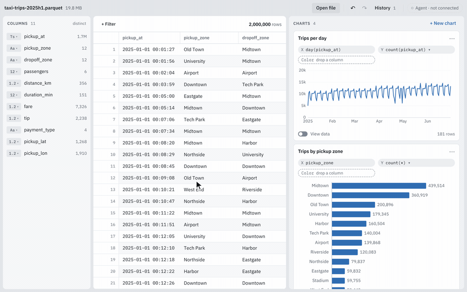
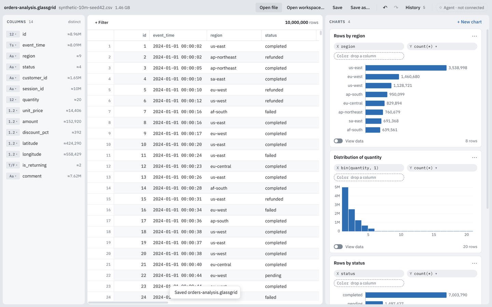
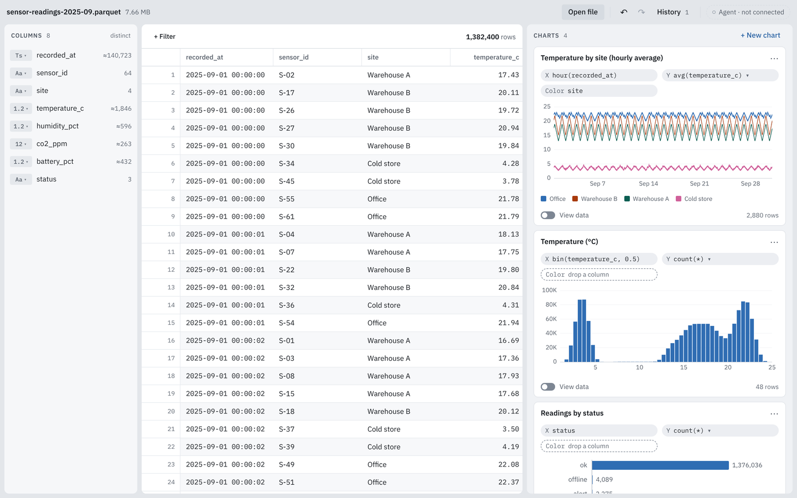
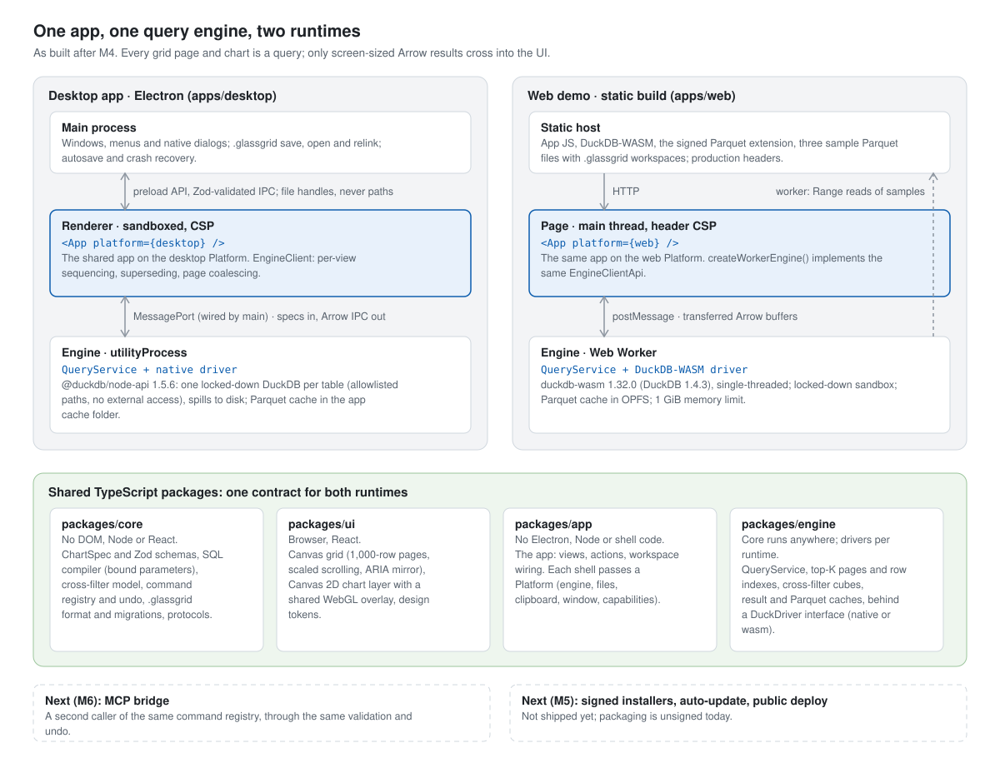

# Glassgrid

[](https://github.com/Kaleb-kougl/glassgrid/actions/workflows/ci.yml)

Open a multi-gigabyte CSV on your own machine, scroll it in a canvas grid and
cross-filter linked charts over it. An embedded DuckDB computes every number,
in an Electron desktop app or entirely in the browser.



<sub>The web demo on its 2M-row taxi sample: brush a date range, click a bar, undo.
Also as [MP4](docs/images/showcase/crossfilter-demo.mp4) and [WebM](docs/images/showcase/crossfilter-demo.webm).</sub>

<!-- TODO(deploy): the demo URL below is the only link to the deployment in this file. Replace it, and drop the "not deployed yet" note, after the first Vercel deploy. -->
**Try it:** web demo at <https://glassgrid.vercel.app> (**TODO: not deployed yet**),
with sample links `/?sample=taxi`, `/?sample=retail` and `/?sample=sensors`.
**Desktop:** there is no signed download yet (milestone M5); `pnpm package`
builds an unsigned installer for your OS (see [Develop](#develop)).

## Numbers

| Measured | Result | Budget | Source |
| --- | --- | --- | --- |
| Cross-filter, 4 charts + grid, 10M rows: brush release → every other view painted | p50 66.0 ms, **p95 80.5 ms** | p95 < 100 ms | [m3 exit gate](docs/benchmarks/m3/m3-exit-gate-medians-linux-x64.json) |
| Open a 10M-row (329 MB) CSV → first rows painted | **315 ms** | < 2 s | [m2 exit gate](docs/benchmarks/m2/m2-exit-gate-medians-linux-x64.json) |
| Scroll 10M rows: p95 frame interval; renderer memory before → after a full scroll | **16.7 ms**; 181 → 183 MB | 60 fps; flat, < 300 MB | [m2 exit gate](docs/benchmarks/m2/m2-exit-gate-medians-linux-x64.json) |
| Chart create on 10M rows (drop → drawn), p95: bar / line / histogram / **heatmap** | 88.8 / 196.5 / 206.1 / **257.1 ms** (heatmap misses) | < 250 ms | [m3 exit gate](docs/benchmarks/m3/m3-exit-gate-medians-linux-x64.json) |
| Web demo, cold: sample link → all four charts drawn; brush → every view painted | 3.0–3.2 s; 115–265 ms | | [web demo samples](docs/benchmarks/m4/web-demo-samples-chromium-linux-x64.json) |
| Web demo first-load JS, gzip (DuckDB-WASM loads later, in a worker, on first intent) | **253.5 kB** | < 400 kB | `pnpm --filter @glassgrid/web size` at this commit ([M4 recorded 251 kB](docs/technical-design.md#m4--persistence-and-web-demo-week-4)) |

Conditions: a Linux VM with 2 vCPUs (Xeon @ 2.1 GHz) and 8 GB, medians of three
runs. Desktop: Electron 44 under Xvfb with software rendering; chart and
cross-filter numbers use the background Parquet copy of the CSV. Web: headless
Chromium against the production build on localhost, so downloads are nearly
free; later runs on a busier VM put the first chart at 3.7–4.4 s
([web demo notes](docs/m4-web-demo.md#architecture)). The budgets were set for the macOS arm64 CI
runners, where they have not been measured yet. The heatmap miss is query time:
a compute-bound aggregate of about 175 ms on two cores
([M3 notes](docs/m3-notes.md#exit-gate)).

| Desktop: a 1.5 GB, 10M-row CSV, four charts, workspace saved | Web demo: the sensor-readings sample |
| --- | --- |
|  |  |

More screenshots: [start screen](docs/images/showcase/web-start.png),
[retail sample](docs/images/showcase/web-retail.png),
[a brushed date range](docs/images/showcase/web-taxi-brushed.png),
[dark theme](docs/images/showcase/web-taxi-dark.png),
[unsaved changes on the desktop](docs/images/showcase/desktop-csv-charts.png).

## How it works



- **The UI never holds raw rows beyond the screen.** Each grid page and chart is a
  typed spec compiled to SQL in `packages/core`; the engine returns Arrow sized to
  the view: a 1,000-row grid page, or a chart's aggregated (or M4-downsampled) rows.
- **One app, two runtimes.** `packages/app` renders the same React app on a
  desktop or web `Platform`; `packages/engine` runs the same query service on
  native DuckDB in an Electron `utilityProcess` or on DuckDB-WASM in a Web Worker,
  which the web demo starts only on first intent (a sample link, or pointing at
  Open or a sample).
- **Every action is a command.** Clicks, menus and keys dispatch typed, validated
  commands with undo, so an MCP agent (M6) can drive the same registry.

Full design, alternatives considered and budgets: [technical design](docs/technical-design.md).
The story behind it: **[case study](docs/case-study.md)**.

## Interesting problems

- **Paging 10M rows without deep OFFSETs.** The first 5,000 sorted rows come from
  one top-K query while a row-number index builds in the background; deep pages
  on a CSV read a Parquet copy. First sorted page at 10M: 6.0 → 2.3 s on CSV,
  2.5 → 0.28 s on Parquet ([M2 engine notes](docs/m2-engine-notes.md#paging)).
- **Cross-filter cubes.** At pointer-down, each other view pre-aggregates by the
  brushed axis; brushes then re-sum small cubes instead of scanning. Engine bench
  at 10M Parquet: p95 963 → 87 ms ([M3 cross-filter notes](docs/m3-xfilter-notes.md#engine-the-brush-cube)).
- **Integer time-bucket keys.** Grouping hours on `floor(epoch_us / 3.6e9)` instead
  of `date_trunc` brought line-chart create from 245 / 289 ms to 167 / 197 ms
  (p50 / p95), checked against the old SQL by property tests
  ([M3 notes](docs/m3-notes.md#chart-create-fixes-after-the-first-exit-gate-run)).
- **One engine behind a driver interface.** The same engine suite runs on native
  DuckDB and on DuckDB-WASM; on 1M rows both give identical answers apart from
  floating-point summation order ([engine portability](docs/m4-engine-portability.md)).
- **Arrow and Zod under a strict CSP.** No `unsafe-eval`: Arrow's vector builders
  and Zod's fast parsers generate code at runtime, so the worker builds vectors
  with plain closures and Zod runs jitless ([web demo notes](docs/m4-web-demo.md#headers-and-csp)).
- **Agent parity, enforced.** 25 commands, each with a Zod input, a permission tier
  and Immer patches for undo; a test fails if a command is neither exposed to MCP
  nor exempted with a reason ([command registry](docs/m1-commands.md#parity-enforcement)).

## Tech stack

TypeScript 6 · React 19 · Electron 44 (sandboxed renderer, `utilityProcess`) ·
DuckDB 1.5.6 (`@duckdb/node-api`) and DuckDB-WASM 1.32.0 · Apache Arrow IPC ·
Zod 4 · Immer · d3-scale and d3-shape over Canvas 2D, WebGL for dense scatter ·
Vite 8 and electron-vite · Vitest, fast-check, Playwright, axe-core · pnpm 10 workspaces.

## Repository layout

| Path | What |
| --- | --- |
| `apps/desktop` | Electron shell: main (windows, menus, dialogs, `.glassgrid` files, autosave), preload, the renderer entry, and the engine host in a `utilityProcess` |
| `apps/web` | Web shell: the same app on DuckDB-WASM, three sample workspaces, production headers ([notes](docs/m4-web-demo.md)) |
| `packages/core` | Platform-neutral TypeScript: specs and Zod schemas, SQL compiler, cross-filter model, commands and undo, workspace format, protocols |
| `packages/engine` | Query service, paging, cubes and caches behind a DuckDB driver interface; native and WASM drivers, the web worker ([notes](docs/m4-engine-portability.md)) |
| `packages/app` | The React app and its `Platform` interface, shared by both shells ([notes](docs/m4-app-package.md)) |
| `packages/ui` | Canvas grid, chart layer, design tokens |
| `tools/datasets` | Pinned, reproducible benchmark CSVs and the web demo's sample datasets ([README](tools/datasets/README.md)) |
| `tools/showcase` | `pnpm showcase`: rebuilds and captures every image and video in [docs/images/showcase](docs/images/showcase) |
| `docs` | Technical design, milestone notes, benchmark JSON |

## Develop

Needs Node.js 22.18+ (CI uses 24, see `.nvmrc`) and pnpm 10 (`corepack enable`).

```sh
pnpm install
pnpm dev          # desktop app with hot reload
pnpm dev:web      # web demo (vite dev server)
pnpm build        # build desktop (electron-vite) and web (vite)
pnpm lint         # ESLint, including the package boundary rules
pnpm typecheck    # tsc for every package and process
pnpm test         # Vitest unit and property tests
pnpm e2e          # build, then Playwright E2E on a generated 1M-row CSV, then the engine in Chromium
pnpm e2e:10m      # the same with 10M rows (the exit-gate benchmarks)
pnpm e2e:web      # web demo E2E on the production build with production headers
pnpm package      # electron-builder installer for the current OS (unsigned)
pnpm showcase     # rebuild, then regenerate docs/images/showcase (2–5 min; about 2 more on first run)
```

E2E writes benchmark JSON to `apps/desktop/e2e-results/`. On Linux without a
display, run it under `xvfb-run -a`. Electron downloads its binary on first use;
if that is interrupted, run `pnpm --filter @glassgrid/desktop exec install-electron`.

## Status

| Milestone | State |
| --- | --- |
| M0 Spike and scaffold | Done ([notes](docs/m0-notes.md)) |
| M1 Data path and command registry | Done ([notes](docs/m1-notes.md)) |
| M2 Virtualized grid | Done; exit gate met on the dev VM ([notes](docs/m2-notes.md)) |
| M3 Charts and cross-filtering | Done; exit gate partly met: heatmap create p95 is 257 ms against 250 ms ([notes](docs/m3-notes.md)) |
| M4 Persistence and web demo | Done except the public deploy and the Firefox and Safari passes ([persistence](docs/m4-persistence.md), [web demo](docs/m4-web-demo.md)) |
| M5 Ship v1.0 | Next: screen-reader passes, designed states, signed installers and auto-update, usability check |
| M6 MCP bridge | Planned: agents drive the command registry over MCP, with tiers, undo and an activity panel |

The plan through v2 is in the [technical design](docs/technical-design.md#milestones).

## License

[MIT](LICENSE) © 2026 Kaleb Kougl
