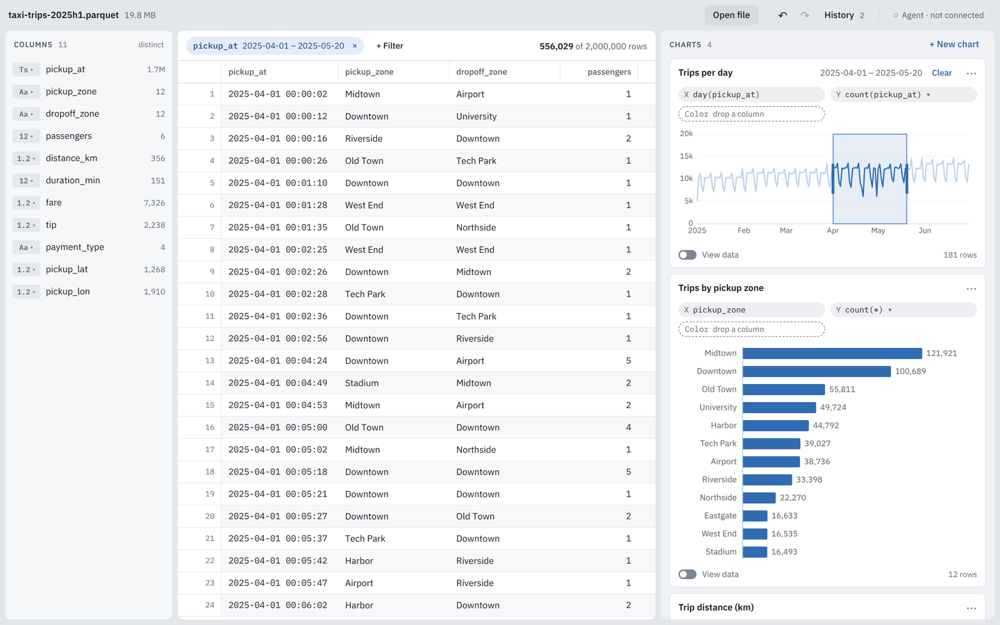

# Glassgrid: a case study

Glassgrid opens a multi-gigabyte CSV locally, shows it in a virtualized canvas
grid, and turns columns into linked charts that cross-filter each other. It
runs as an Electron app on native DuckDB and as a static web demo on
DuckDB-WASM, from one React app and one query engine. This page covers the
constraints, the four problems that took the most work, and the measurements.
The [technical design](technical-design.md) has the alternatives considered
for each layer; the [README](../README.md) has the demo link.

## The problem

Spreadsheets stall past about a million rows. Notebooks handle the scale but
need code. A chat assistant can chart an upload, but each step is a round trip,
generated code can silently drop nulls or mis-bucket dates, and the data leaves
the machine. The target user knows their data, not SQL, and wants to explore a
10M-row export repeatedly, with numbers they can trust.

## Constraints

- **The UI never holds raw rows beyond the screen.** Every grid page and every
  chart is a query; only a screen-sized Arrow result crosses into the renderer.
- **Budgets with a benchmark each** ([technical design](technical-design.md#performance-budgets)):
  first rows of a 10M-row, ~1 GB CSV in under 2 s; scrolling at 60 fps with flat
  memory; a new chart in under 250 ms; a cross-filter update across four charts
  and the grid in under 100 ms at p95; web first-load JS under 400 kB gzip.
- **An untrusted renderer.** It is sandboxed, never sees a file path and never
  writes SQL: requests are typed specs, validated with Zod at every boundary
  and compiled with bound parameters. Each table gets its own DuckDB instance
  with external access off and an allowlist of its file and the cache folder.
- **MIT dependencies only**, which is one reason the grid is built in-house.
- **The same app in the browser**, for a zero-install demo.

## Architecture

Four packages carry the product; two thin shells host them. `packages/core`
holds the contract (specs and Zod schemas, the SQL compiler, the cross-filter
model, commands, the `.glassgrid` format) and imports no DOM, Node or React.
`packages/engine` is the query service over a small `DuckDriver` interface.
`packages/ui` draws the grid and charts. `packages/app` is the React app,
written against a `Platform` interface that each shell implements.

On the desktop, main wires a `MessagePort` between the renderer and the
engine's `utilityProcess`, so queries never pass through main. On the web, the
same engine runs in a Web Worker, reached by `postMessage` with transferred
Arrow buffers. Both clients implement one `EngineClientApi` with per-view
sequence numbers: a newer request supersedes a stale one.

## Hard problems

### 1. Paging 10M rows without deep OFFSETs

M1 materialized a `row_number() OVER (ORDER BY …)` index before showing the
first sorted page: 6.0 s at 10M rows on CSV, 2.5 s on Parquet. Measuring
DuckDB's planner showed it uses a heap top-N only when `LIMIT + OFFSET` is at
most 5,000 (or a tiny fraction of the estimated input); past that, a "deeper
top-K" is a full sort.

**Decision:** the first 5,000 sorted rows come from one cached top-K query, and
every page inside it is an Arrow slice. Then the index builds in the
background, and later pages are range reads (5 to 7 ms at any depth). A
property test checks that both paths return identical rows, ties included.

Deep *unsorted* pages on a raw CSV re-parse the file on every OFFSET (1.8 to
3.1 s at 10M). Of four options measured, a background Parquet copy keyed by
the file's fingerprint cost about one deep scan (2.0 s) and made every later
page 8 to 16 ms. On two cores a CSV scan costs about as much as the
conversion, so full scans wait for a running conversion instead of competing.

**Result:** first sorted page at 10M rows went from 6.0 to 2.3 s on CSV and from
2.5 to 0.28 s on Parquet ([M2 engine notes](m2-engine-notes.md#paging),
[bench JSON](benchmarks/m2/engine-bench-medians-linux-x64.json)). The cost: a
deep sorted page requested right after sorting waits for the index.

### 2. Cross-filtering 10M rows in under 100 ms

The design deferred pre-aggregation until a brush benchmark proved it was
needed. It did: on the M2 engine, a brush across four charts and the grid took
p50 618 ms and p95 963 ms at 10M rows on Parquet.

**Decision:** Mosaic-style cubes. At pointer-down, the engine builds, for
every other view, a table grouped by that view's keys and the brushed bin,
with decomposable partials (count, sum, min, max). A brush snaps outward to
whole bins, and each view re-sums the covered cells with its own SQL shape, so
top-N, "Other" and M4 downsampling still apply. Snapping uses the smallest
double at each bin edge (17 × 0.1 is 1.7000000000000002, but 1.7 belongs to
bin 17), so a brush selects exactly the rows the histogram draws. A hint the
engine cannot use falls back to the plain query, so sending one is never
wrong. The grid's count gets its own cube, and its first filtered page streams
`LIMIT 1000`.

**Result:** engine bench p50 35.5 ms, p95 87.3 ms
([cross-filter notes](m3-xfilter-notes.md#numbers)); in the app, brush release
to every other view painted, p50 66.0 ms and **p95 80.5 ms**, with 80 of every
100 view answers from cubes ([exit gate](benchmarks/m3/m3-exit-gate-medians-linux-x64.json)).
The cost: the first brush on an axis waits for its cubes (249 ms median at 10M
on Parquet; about 5 s on a raw CSV before its Parquet copy exists).

### 3. Chart create: integer keys, and knowing when to stop

The first M3 exit-gate run missed chart create (drop to drawn, < 250 ms) for
the line chart: 245 / 289 ms p50 / p95, almost all of it engine time. On the
10M Parquet copy, a bare GROUP BY on `date_trunc('hour', ts)` took 175 to
190 ms, on `time_bucket` 190 ms, and on a sign-aware
`floor(epoch_us / 3.6e9)` 118 ms.

**Decision:** the compiler groups hour buckets of zone-less timestamps on the
integer key and day buckets on `CAST(ts AS DATE)`, and converts back to a
timestamp only on the aggregated rows. Property tests compare the old and new
SQL value for value on edge data: both sides of the epoch, hour and day edges,
years 1 to 9999, ±infinity. Heatmaps got a single packed cell key, and the
hidden screen-reader table now renders after the chart is painted.

**Result:** line create 167 / 197 ms. The heatmap is still at **257 ms p95**
against 250 ([M3 notes](m3-notes.md#exit-gate)). A render-path profile put
everything outside the engine at about 9 ms
([render baseline](render-perf-baseline.md)), and EXPLAIN ANALYZE showed a
compute-bound aggregate of about 175 ms on two 2.1 GHz cores. Several other
key encodings were no faster, so the miss is recorded, not hidden; the next
step is measuring on the macOS arm64 runners the budgets were set for.

### 4. One app on two engines, under a strict CSP

The engine moved out of the Electron host into a runtime-neutral package
behind a small driver interface (connect, query, Arrow, interrupt, and file
access for fingerprints and the cache). The drivers differ where it matters:

- **Native** creates one locked-down DuckDB instance per table, with immediate
  interrupts and spilling.
- **WASM** runs DuckDB-WASM's synchronous bindings inside the engine worker
  (two `postMessage` hops, no third thread). An instance costs about 0.8 s and
  90 MB, so tables `ATTACH` databases on one instance. Statements run as
  pending queries polled from the event loop, so interrupts are cooperative.
  The signed Parquet extension is served from the app's own origin, and since
  npm's `latest` tag was a dev build, the version is pinned to 1.32.0.

The engine suite runs on both drivers, and a shared scenario also runs in
Chromium. On 1M rows the answers match apart from floating-point summation
order.

The web build's CSP allows `'wasm-unsafe-eval'` but not `'unsafe-eval'`.
Testing under the real header, which also governs the worker, found two
code-generation paths: Arrow's `vectorFromArray` compiles a null check with
`new Function` (it broke a grid page with list columns), and Zod probes for
JIT support on every load. Vectors are now built with plain closures and Zod
runs jitless; a unit test replaces `Function` with a thrower, and every web
E2E fails on any CSP violation.

**Result** ([engine portability notes](m4-engine-portability.md#numbers),
[web demo notes](m4-web-demo.md#timings)): on 1M rows, single-threaded WASM is
2 to 6 times slower than native on full scans, but a cube-answered brush takes
43 ms (native 30 ms). A sample link draws all four charts 3.0 to 3.2 s after
navigation, cold, on localhost.

## State you can trust

- **Commands.** Every user action is one of 25 typed commands, each with a Zod
  input, a permission tier and Immer patches that form its undo entry. A parity
  test fails if a command is neither exposed to MCP nor exempted with a reason;
  four are exempt, such as `openFile`, whose input is engine metadata an agent
  cannot supply truthfully ([command registry](m1-commands.md)).

  

- **Workspace files.** A `.glassgrid` file is versioned JSON that references
  the data by relative path, absolute path and a fingerprint (size, mtime,
  SHA-256 of the first and last 1 MB). Opening tries both paths, then asks the
  user to locate the file, and warns when the fingerprint differs. Writes are
  atomic; unsaved work autosaves ([persistence notes](m4-persistence.md)).

## Results

| Budget | Target | Measured (10M rows unless noted) | Source |
| --- | --- | --- | --- |
| Open → first rows painted | < 2 s | 315 ms | [M2 exit gate](benchmarks/m2/m2-exit-gate-medians-linux-x64.json) |
| Scroll, p95 frame interval | 16.7 ms | 16.7 ms, memory 181 → 183 MB | same |
| Sort → first sorted rows | < 1 s | 249 ms | same |
| Chart create, p95: bar / line / histogram | < 250 ms | 88.8 / 196.5 / 206.1 ms | [M3 exit gate](benchmarks/m3/m3-exit-gate-medians-linux-x64.json) |
| Chart create, p95: heatmap | < 250 ms | **257.1 ms (missed)** | same |
| Cross-filter, 4 charts + grid, p95 | < 100 ms | 80.5 ms | same |
| Web first-load JS (gzip) | < 400 kB | 251 kB | [M4 result](technical-design.md#m4--persistence-and-web-demo-week-4) |
| Web demo, sample link → all charts (1.4M–2M rows) | | 3.0–3.2 s | [web demo samples](benchmarks/m4/web-demo-samples-chromium-linux-x64.json) |

All on a Linux VM with 2 vCPUs (Xeon @ 2.1 GHz) and 8 GB, medians of three
runs: the desktop in Electron under Xvfb with software rendering, on the
background Parquet copy; the web demo in headless Chromium from localhost.

## Limitations

- **Hardware.** The budgets were set for macOS arm64 CI runners, and every
  number above comes from a 2-core Linux VM. Scrolling was measured with
  software compositing, and the WebGL scatter at 1M points has not been
  verified on a real GPU.
- **Raw CSV before the Parquet copy.** The first brush waits about 5 s for its
  cubes, and a selective brush can take 1.6 to 1.9 s to find a page of matches.
- **The web demo** is not deployed yet, is untested in Firefox and Safari, has
  no workspace save, and is single-threaded (no cross-origin isolation). A
  second tab cannot read the same OPFS cached copy.
- **Rendering.** The app re-renders the whole tree around each interaction;
  65 to 90% of those component renders are wasted. It costs milliseconds, not
  the budget, but it is the next cleanup.
- **Data.** Distinct counts are approximate, and the sample datasets and the
  exit-gate benchmark files are synthetic, not real taxi records.

## What's next

M5 ships v1.0: VoiceOver and NVDA passes, designed empty and error states,
signed installers with auto-update, the public deploy, and a usability check
(three testers, three correct charts each from an unfamiliar 5M-row file, in
under five minutes). M6 adds the MCP bridge: the user's own AI app drives the
same command registry, with the same tiers and undo, while DuckDB still
computes every number.
