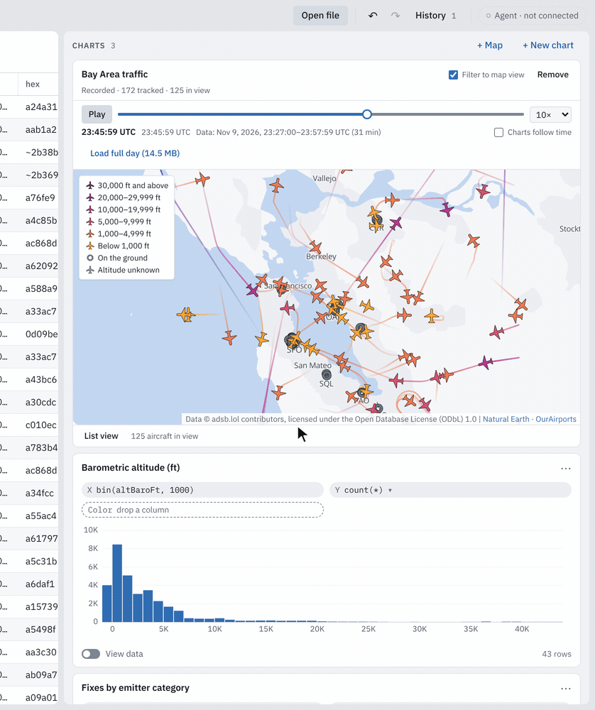

# Live flights

Real air traffic over the San Francisco Bay Area in Glassgrid's web demo: a
map of the aircraft, linked to the charts and the grid like any other view,
fed every 20 s by the portfolio site's relay of [adsb.lol](https://adsb.lol),
or by a recorded day when live data is not wanted or not available. This is
the entry point; each milestone has its own note with the detail (links at
the end).



<sub>The recorded half hour (`?sample=flights`): brush altitude → the map keeps those aircraft; pan → the charts and the grid follow the map's view; scrub → back in time.
Also as [MP4](images/showcase/flights-demo.mp4) and [WebM](images/showcase/flights-demo.webm); stills in [light](images/showcase/flights-map.png) and [dark](images/showcase/flights-map-dark.png).
Aircraft data © adsb.lol contributors, ODbL 1.0.</sub>

| Link | What it opens |
| --- | --- |
| `/glassgrid/?sample=flights` | The busiest 30 minutes of 2026-11-09 (71,595 fixes), loaded whole and played at 10×; "Load full day" swaps in all 1,456,777 fixes. Works anywhere the demo is hosted. |
| `/glassgrid/?live=1` | Live traffic from `/api/flights`, polled every 20 s. **Needs the portfolio's relay** on the same origin; elsewhere (a standalone build, `vite preview`) the feed retries and offers the recording. |

## Architecture

```
adsb.lol /v2/point/37.75/-122.25/60           (volunteer-run; slow TLS handshake: 9 to 45 s measured)
   │  one call per 10 s per server instance, User-Agent identifies the site
   ▼
portfolio relay  GET /api/flights              (Next.js route on Vercel, sswe-portfolio: src/lib/flights/)
   │  undici keep-alive pool: idle connection kept 5 min, 45 s to connect, 50 s per call
   │  box filter, ≤ 2,000 aircraft, last good snapshot served `stale: true` for ≤ 10 min, else 503 + Retry-After
   │  Cache-Control: s-maxage=10, stale-while-revalidate=20  →  Vercel CDN collapses every viewer onto it
   ▼
browser, same origin (CSP connect-src 'self')
   engine Web Worker: AdsbLolSource (fetch, no-store, 20 s timeout, backoff, Retry-After)
     → FlightStore: DuckDB-WASM table flight_states (fixture's types, dedup, 60 min retention), one transaction per batch
     → QueryService: the live table is a table like any file; caches versioned per batch
   main thread: map query (latest fix per aircraft ≤ T, trails, selected track) + chart and grid queries
     → MapLibre map (lazy chunk) with a custom WebGL aircraft layer + dead reckoning
     → charts and grid, cross-filtered with the map's viewport (and the map with their brushes)
```

The recorded sources (`?sample=flights`, "Load full day", the fallback) skip
the network: `ArchiveSource` loads a committed Parquet fixture into the same
`flight_states` table, and the time scrubber moves the map's clock T through
it, so a seek is a query, not a re-ingest.

## Key decisions

| Decision | Why |
| --- | --- |
| A same-origin relay instead of calling adsb.lol from the page | The demo's CSP is `connect-src 'self'`; the relay also caches for everyone (one upstream call per 10 s whatever the traffic), hides adsb.lol's failures behind stale data, and is the one place a future API key would live. |
| Poll every 20 s, never more than once per 10 s | The CDN caches 10 s, so faster polls only cost requests (Vercel Hobby: 1M CDN requests a month, about 5,600 viewer-hours at 20 s). The 10 s floor holds across restarts, source switches and visibility changes; hidden tabs do not poll. |
| Ingest in the engine worker, into DuckDB with the fixtures' exact types | A batch never crosses `postMessage`; live and recorded data compile to the same SQL; the replay gate can compare the table with the fixture cell for cell (it passes on native DuckDB and DuckDB-WASM). |
| Dedup by (hex, ts), plus "same aircraft, same stored position, within 2 s" | readsb re-reports a fix with a slightly different computed time on every poll; quantising time fails at bucket edges. Property-tested for idempotence. |
| The live table is versioned per batch | Every cached result, cube, sort index and profile of the previous batch is dropped before the batch is announced, so no view ever shows an older batch's answer. |
| MapLibre with a self-hosted Natural Earth / OurAirports basemap, as a lazy chunk | No third-party tiles or fonts (CSP unchanged, no tracking), 137 KB of map data; MapLibre's 294 kB stays out of first load. An OpenStreetMap PMTiles basemap is documented but not built (its source was unreachable here). |
| One custom WebGL layer for aircraft and trails, drawn between fixes by dead reckoning | Smooth motion from 20 s fixes; capped at 60 s of extrapolation; picking on the CPU. Property-tested. |
| The map's viewport is its selection; pans are not undoable | Charts and grid show what the map shows; the camera cannot be undone, so an undone box would filter by something the map no longer shows. |
| "As of T": the clock is a view parameter | Scrubbing and playing re-query at T; nothing is re-ingested, and the charts can follow T or not ("Charts follow time", off by default so brushes describe the whole recording). |
| Offline → replay is offered, never automatic (L5) | Switching data under someone without telling them is worse than an empty map. The offer appears when the browser is offline, after three failed polls in a row, when a 429 asks to wait a minute or more (judged by the delay the feed reports, not by a clock), or after two minutes of stale data. Three failures take 20 s when the relay answers 503 with `Retry-After: 10`, 30–60 s for fast errors (backoff 10–20 s, then 20–40 s), and 90–120 s when every poll waits out its 20 s timeout, counted from the first failing poll. The recording (0.76 MB) is fetched into memory when a live feed starts, so it plays offline. The choice is kept for the tab once the recording has loaded; "Back to live" appears once a probe (one GET a minute, and at once when the browser comes back online) finds fresh data, and probing then stops. |
| A screen-reader table of the aircraft in view (L5) | The map is a canvas. The list mirrors exactly what the map draws within its view, sorted by callsign so rows do not jump, with row selection shared with the map. It is not a live region (it changes every second); only its count is announced, politely, at most every 10 s, while focus is in it. |

## L5: states, fallback, list view

**Feed states**, each distinct in the map card's status line, the top bar,
and a polite live region (announced once per change, never the countdown):

| State | Status line | Cause |
| --- | --- | --- |
| Connecting | "Connecting to the live feed…" | started, no answer yet |
| Live | "Live · 40 aircraft", or "Live · 172 tracked · 122 in view" when some aircraft are outside the map's view | the last poll succeeded |
| Stale | "Stale data · last update 15:02:31" | the relay says `stale: true`, or no success for max(30 s, interval + timeout + 2 s) = 42 s at the default 20 s poll |
| Rate-limited | "Rate-limited · retrying in 95 s" | HTTP 429 (or the relay's 503 whose `reason` is the upstream's `HTTP 429`); waits for `Retry-After` |
| Offline | "Offline · retrying in 12 s" | `navigator.onLine` is false |
| Retrying | "Retrying in 14 s · adsb.lol is slow to respond (HTTP 503)" | any other failure, exponential backoff with jitter; a relay 503 shows its `reason` in words (`timeout`: adsb.lol is slow to respond; otherwise its short code), a client timeout "no answer within 20 s" |

The status line sits under the card's header (which keeps the title, the
switch and Remove), wraps to two lines at most, and carries the whole text
in its tooltip.

The stale threshold is 42 s rather than a flat 30 s: one 20 s poll plus the
20 s request timeout would otherwise flicker to "Stale" on every slow cold
relay answer (L2).

**Offline → replay**: `packages/app/src/live-fallback.ts` (the rule and the
probe), `views/LiveFallbackNotice.tsx` (the strip in the map card),
`apps/web/src/web-platform.ts` `webLive` (`navigator.onLine`, the probe,
sessionStorage key `glassgrid.flights.choice`), and the engine worker's
`prefetchFixture` (the 30-minute fixture fetched into memory as a `File`
when a live source starts; a failed prefetch falls back to HTTP reads).

- The strip says what the recording is doing: loading, showing ("Showing
  recorded traffic… because the live feed was unavailable"), or that it
  didn't load and why (offline before it could be fetched ahead), with
  "Try again"; a failed recording is tried again when the browser comes
  back online, and the choice is only remembered once it has loaded.
- A reload of `?live=1` in a tab that chose the recording opens the
  recording at once and says why.
- "Keep trying" dismisses the current reason only: a more serious one
  (stale < failing < rate-limited < offline) offers the recording again,
  as does a new failure after the feed recovered.
- The polite region says each offer once, without the failure count, so
  every further failure is not announced again.
- Focus: each of the strip's buttons removes itself; focus moves to the
  strip that replaced it (after "Watch the recorded traffic instead") or
  to the map card (after "Keep trying", "Back to live").
- The probe is aborted when the page is hidden, goes offline or the card
  goes, and stops once it has found live data, so "Back to live" cannot
  come and go.

Tested in the app with a fake feed, and end to end against a scripted
stand-in relay in `apps/web/e2e/serve.ts` (`GLASSGRID_E2E_RELAY=1`, which
can also fail the fixtures): live → three 503s → the offer → Keep trying →
recovery → a 429 with a 120 s Retry-After → the recording (no more polls) →
reload → offline/online → probe → Back to live; offline before choosing
(the recording loads from memory); and a recording that could not be
fetched ahead (it says so, keeps no choice, and loads once back online)
(`e2e/flights-live.spec.ts`).

**List view**: `packages/app/src/views/AircraftList.tsx`. A `role="grid"`
table (callsign, type, altitude, ground speed, heading, vertical rate) of
the aircraft whose latest fix is inside the map's last reported viewport,
after every filter. Like the grid's ARIA mirror (`CanvasGrid.tsx`): a roving
tab stop, arrows, Page Up/Down, Home/End (Ctrl for the first and last row),
`aria-rowcount`, `aria-selected` rows. Enter, Space or a click selects the
aircraft on the map; a selection on the map marks its row; Escape clears.
Visually hidden by default, inside the map's box: still in the tab order,
and shown over the bottom of the map while it has focus (a sighted keyboard
user never has an invisible focus, and nothing on the page moves); "List
view" under the map shows it in the card's flow. When the focused row's
aircraft leaves the view, focus moves to the cell now at its place. Tab
order in the card: the switch, Remove, the scrubber, the map (and its
attribution links), the list, List view. axe-core finds nothing on
`?sample=flights` with the list hidden and shown, in both themes
(`e2e/flights-a11y.spec.ts`).

**Cross-browser.** The web E2E runs in Chromium by default;
`GLASSGRID_E2E_BROWSERS=chromium,firefox,webkit` adds Playwright's Firefox
and WebKit (`apps/web/playwright.config.ts`). The specs use DOM, keyboard,
pointer, `setOffline` and a server-side relay only; aborted-request
filtering knows each browser's wording; the two Chromium-only benchmarks
skip elsewhere. CI's `web-browsers` job installs both browsers and runs the
flights specs and the smoke test (allowed to fail until its first green
run). Locally:

```sh
pnpm --filter @glassgrid/web exec playwright install firefox webkit   # Linux: add --with-deps
pnpm --filter @glassgrid/web build
GLASSGRID_E2E_BROWSERS=firefox,webkit pnpm --filter @glassgrid/web exec playwright test e2e/flights.spec.ts e2e/flights-a11y.spec.ts e2e/flights-live.spec.ts
```

## Numbers

Linux VM, 2 vCPUs (Xeon @ 2.1 GHz), 8 GB, no GPU (Chromium 153 headless,
WebGL on SwiftShader), DuckDB-WASM 1.32.0 in the page's worker, files from
localhost. The 100 ms and 16.7 ms targets were set for GPU machines and are
**not met here**; the GPU runs are an owner step ([deploy.md](deploy.md#live-flights)).

| Measured | Result | Source |
| --- | --- | --- |
| Brush the altitude histogram → every other view painted (map, two charts, grid), p50 / p95 | 30-minute fixture 106.9 / **157.0 ms** (an earlier run 87.6 / 104.0); day 97.6 / **125.7 ms**; target p95 < 100 ms | [L4](live-flights-l4.md#numbers), [JSON](benchmarks/l4/flights-perf-chromium-linux-x64.json) |
| Map frame interval, 183 aircraft with trails, panning, 1280×800, p95 | 66.8 ms (the basemap alone: 66.7); the aircraft layer's own CPU time 0.7 ms; target 16.7 ms | [L3 map](live-flights-l3-map.md#frame-times) |
| Load the full day (1,456,777 fixes, 14.5 MB Parquet) → table, profile and views | 3.4 s (3.4–4.5 s over 4 runs) | [L4](live-flights-l4.md#time-scrubber-and-history) |
| Aircraft in view at once over the recorded day | peak **183**, median 79 (10 s snapshots) | [L0](live-flights-l0.md) |
| Web first-load JS, gzip | **276.9 kB** of 400 (L4: 271.3; L5's states, fallback and list view +5.6) | `pnpm --filter @glassgrid/web size` |
| Map chunk (MapLibre and the component), gzip | 294.2 kB JS + 10.3 kB CSS + 148.0 kB worker, loaded on the first map | `pnpm --filter @glassgrid/web size` |
| Replay gate: the 30-minute fixture through the feed into `flight_states` | equal to the fixture, 71,595 rows, native and WASM | [L2](live-flights-l2.md) |

## Licensing

- **Flight data: ODbL 1.0**, © adsb.lol contributors. The committed fixtures
  are a derived database under the same licence
  (`apps/web/public/samples/flights/LICENSE-ODbL.md`), not under Glassgrid's
  MIT licence. Every map shows the credit from the data (the relay's
  `attribution`, or the fixture's) in its attribution control.
- **Basemap: public domain.** Natural Earth 10m (land, lakes, urban areas,
  places) and OurAirports (airports, runways), at pinned commits, credited
  on the map.
- **Glyphs: SIL OFL 1.1.** Noto Sans Regular SDF glyphs (0–255) from
  protomaps/basemaps-assets, with `OFL.txt` beside them.
- **Code:** MapLibre GL JS 6.16.0 (BSD-3-Clause) and its dependencies are
  listed in `THIRD_PARTY_NOTICES.md` (`node scripts/third-party-notices.js
  --check`). `@axe-core/playwright` (MPL-2.0) is a test-only dev dependency
  and ships nowhere.

## Unverified

- **The real relay in a browser.** Everything live was tested against mocks
  and the scripted stand-in; adsb.lol is not reachable from this
  environment, and the portfolio's route was never run with this build. The
  timing semantics L2 lists (`now` vs `seen_pos`, what `stale` looks like,
  whether a CDN hit repeats `now`) are still open.
- **`x-vercel-cache` and one upstream call per 10 s** on the deployed
  portfolio: to check after deploying ([deploy.md](deploy.md#live-flights)).
- **GPU numbers**: the brush and frame-time targets on real hardware.
- **Firefox and WebKit**: the specs are browser-agnostic and the CI job is
  ready, but neither browser ran here.
- **A screen reader by hand** (NVDA, VoiceOver): the list's semantics are
  checked by axe and the tests, not by listening.
- **A 429 from the relay itself**: the portfolio's route never sends one
  (it serves stale data or a 503); the client handles both, and a 429 from
  Vercel's own protections is the case it would cover.

## Per-milestone notes

| Milestone | Note |
| --- | --- |
| L0 Spike and fixture: the schema, the pinned day from adsb.lol's archive, the recorder | [live-flights-l0.md](live-flights-l0.md) |
| L2 Ingest in the engine worker: sources, `flight_states`, dedup, retention, cadence | [live-flights-l2.md](live-flights-l2.md) |
| L3 The map, data side: the live table, the map spec and queries, workspace format 2 | [live-flights-l3-data.md](live-flights-l3-data.md) |
| L3 The map, component side: MapLibre, basemap, CSP, the aircraft layer, dead reckoning | [live-flights-l3-map.md](live-flights-l3-map.md) |
| L4 Cross-filter and history: the viewport as a selection, the time scrubber, tracks | [live-flights-l4.md](live-flights-l4.md) |
| L5 Polish and ship: states, offline → replay, the list view, cross-browser, showcase | this note; the release steps are in [deploy.md](deploy.md#live-flights) |
| The relay (portfolio repository) | `docs/flights-proxy.md` in `Kaleb-kougl/sswe-portfolio` |
