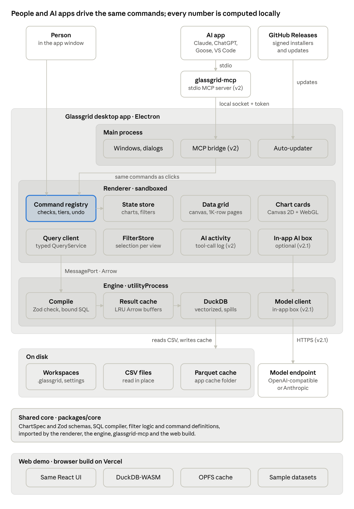
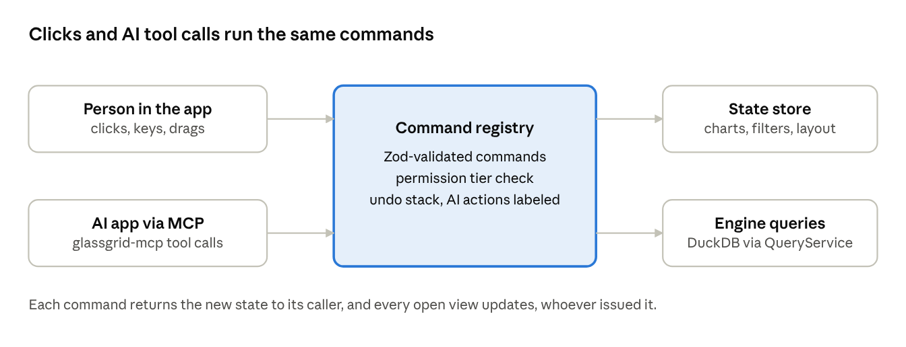
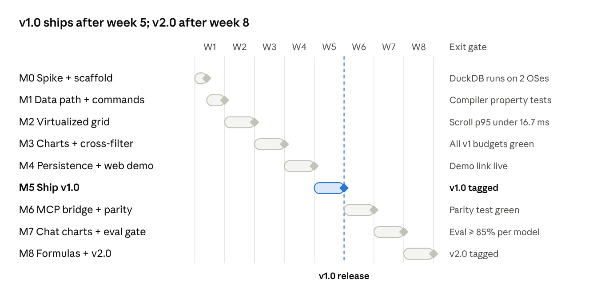

# Glassgrid: Technical Design

Oct 17, 2026 · Kaleb Kougl

> Exported from the living design doc on 2026-10-17: https://claude.ai/code/artifact/92364e0a-803e-4d32-8345-937c7a34ca1b. Edit the doc first, then re-export.


## Overview

Glassgrid is a desktop app (Electron) that opens multi-gigabyte CSV files locally and turns columns into interactive charts with a drag or a typed question. The core design rule: **the UI never holds raw rows beyond what is on screen**. Every grid page and every chart is a query against an embedded DuckDB engine, which returns only the aggregated or visible slice. This mirrors warehouse pushdown in cloud BI tools, scaled down to a laptop.

**Problem.** Spreadsheet apps stall or refuse files past \~1M rows. Notebook tools handle the scale but need code. Non-technical users with a large export have no fast, visual way to explore it.

**Goals (v1)**

- Open a 10M-row, \~1 GB CSV and show the first rows in under 2 s.
- Scroll the full table at 60 fps with constant memory.
- Create a chart by dragging a column, with a sensible default chart type.
- Cross-filter: selecting on any chart filters the grid and every other chart.
- Run the same core in the browser (DuckDB-WASM) for a zero-install demo.

**Non-goals (v1)**

- Editing source data or writing back to files.
- Connecting to remote databases or warehouses.
- Multi-user collaboration, accounts or cloud sync.
- Dashboard publishing or scheduled reports.

**Success criteria.** Every goal above has an automated benchmark in CI (see Performance budgets). A non-technical tester builds three correct charts from an unfamiliar 5M-row dataset in under 5 minutes, unassisted.

## Why not just ask an LLM?

The LLM interprets the question and the engine computes the answer. A chat assistant is the right tool for a one-off question on a small file; Glassgrid is for exploring large files repeatedly, with numbers the user can trust.

| Need | Chat assistant with a file upload | Glassgrid |
| --- | --- | --- |
| File size | Limited by upload caps and a temporary sandbox | Multi-GB files opened locally |
| Speed of each step | Seconds per round trip, plus re-reading a new chart | Under 100 ms per brush, sort or filter |
| Trust in the numbers | Generated code can drop nulls or mis-bucket dates unseen; the same question can produce different code | Deterministic compiler; exact tooltips; "View data" on every chart; AI output is an editable spec, never computed numbers |
| Privacy | Raw data is uploaded | Data stays on the machine; AI features send profiles and summarized results only to the model the user chose |
| Reuse | A conversation, re-prompted each time | A saved workspace reopened on next month's export |
| Cost and offline use | Tokens per question; needs a connection | No per-query cost; works offline |

**Where the LLM is better:** open-ended "why" questions, statistics, cleaning and joining messy files, and writing up findings. These stay out of scope for v1; v2 lets people bring their own model through MCP, but the model only proposes chart specs; the engine computes every number.

## User experience

The target user knows their data but not SQL. Every action is a direct manipulation of columns, and the app picks defaults so the first chart appears with no configuration.

**Layout.** Left: column list with type icons and distinct-value counts. Center: the data grid. Right: a chart canvas holding one or more chart cards.

**Core flows**

1. **Open.** Drag a file onto the window or use File > Open. The grid shows the first rows while column profiling (type, null %, distinct count, min/max) finishes in the background.
2. **First chart.** Drag a column onto the canvas. Glassgrid picks a chart from the column profile (rules below). Dropping a second column on the card adds it as the y-axis, color or facet.
3. **Refine.** Each card has shelves for X, Y, Color and Aggregate (sum, avg, count, min, max). Changes re-query immediately; no Apply button.
4. **Filter.** Brush a range or click a bar. The grid and other cards filter to match. Active filters show as removable chips above the grid.
5. **Export.** Copy a chart as PNG/SVG, or export the filtered rows to CSV.

**Default chart rules (v1)**

| First column type | Default chart | Aggregate |
| --- | --- | --- |
| Date or timestamp | Line, auto time bucket (hour / day / month) | count of rows |
| Category, ≤ 50 distinct | Horizontal bar, sorted descending | count of rows |
| Category, > 50 distinct | Bar of top 20 + "Other" | count of rows |
| Number | Histogram, auto bin width | count of rows |
| Number + number | Binned scatter (heatmap) | count per bin |

**Empty, loading and error states** are designed, not defaulted: a query over 300 ms shows a skeleton on the affected card only; a parse error names the line and column.

## System architecture

The diagram shows the whole project, with v2 parts marked. At its core are three Electron processes with one rule: the sandboxed renderer sends typed specs to a separate engine process and gets back only Arrow slices sized to the screen.



Main owns windows, dialogs and updates, and wires a direct `MessagePort` between renderer and engine at startup, so query traffic skips main. A cache hit returns from the result cache without touching DuckDB.

- **Renderer** (React 19, TypeScript, Vite): grid, chart cards, shelves, `FilterStore`. No Node, no file paths, no SQL.
- **Main**: app lifecycle, menus, native file dialogs and drag-drop, auto-update, IPC setup. Holds no data.
- **Engine** (`utilityProcess`): validation, SQL compilation, result cache and DuckDB. A crash here restarts the engine without losing the window; open views re-issue their queries.
- **Shared core** (`packages/core`): the spec types, Zod schemas, compiler and filter logic, imported by both the renderer and the engine so they agree on one contract.

**v2 adds an MCP bridge.** The `glassgrid-mcp` command, launched by the user's AI app, connects to a local socket owned by main. Main forwards each call to the renderer's command registry, which dispatches it exactly as a click would, so AI-made changes appear live in the open window.

## Command layer and agent parity

Every user action is a typed command, and the UI and the MCP server both dispatch through one registry, so an AI agent can do anything a person can, through the same validation, permissions and undo. The registry ships in v1; v2 only adds MCP as a second caller.



**Commands.** Each command has a name, a Zod input schema, a permission tier, a pure state update and optional engine queries. Examples: `openFile`, `addChart`, `setShelf`, `brush`, `clearFilter`, `sortColumn`, `setColumnType`, `addFormulaColumn` (v2), `saveWorkspace`, `exportCsv`, `undo`. Buttons, menus, keyboard shortcuts and drag-drop all dispatch commands; no UI component changes state directly.

**State in, state out.** A `get_state` call returns the workspace, open charts with their specs, active filters, grid sort and selection. Every command returns the resulting state, so a caller never acts on a stale picture. A `render_view` call returns a PNG of a chart card or the visible grid, so the agent can check its work visually, as a person would.

**Permission tiers**

| Tier | Commands | AI caller |
| --- | --- | --- |
| Read | `get_state`, `render_view`, profiles, chart aggregates | Allowed |
| Edit workspace | Charts, shelves, filters, sort, column types, layout | Allowed; undoable, labeled "by AI" |
| Write files | `saveWorkspace`, `exportCsv`, export chart image | Needs a click in the app; the path is chosen in a native dialog |
| Raw data | Row-level reads beyond the visible grid | Off until enabled per workspace |

**Undo and attribution.** Person and agent commands share one undo stack. The store is a plain reducer over an Immer draft, so each command's patches and inverse patches form its undo entry. Each entry records its caller, so the history and the AI activity panel show "by AI" entries, and the person can step back through anything the agent did.

**Working side by side.** Both callers edit one state store in the renderer. Commands apply in arrival order, each view re-renders from the store, and the person sees the agent's changes live. A brush in progress is not interrupted: agent commands queue until the pointer is released.

**Parity is enforced.** A CI test walks the registry and fails if any command is neither exposed to MCP nor listed in an explicit exemption file with a reason. The same registry also drives Playwright end-to-end tests and the AI evals, so all three exercise the same paths.

## Technology choices

DuckDB, an in-house Canvas chart layer over D3 utilities, an in-house canvas grid and Electron win their layers; the deciding factor each time is that every view is a pushed-down query, so libraries built around holding data in the browser add weight without helping. Versions and maintenance status were checked in October 2026.

| Layer | Pick | Runner-up | Deciding factor |
| --- | --- | --- | --- |
| Query engine | DuckDB 1.5 via `@duckdb/node-api` | nodejs-polars | SQL is the natural target for compiled specs; same engine runs in the browser as DuckDB-WASM |
| Charting | Canvas 2D layer on `d3-scale` / `d3-shape`, WebGL for dense scatter | Apache ECharts 6 | Charts receive pre-aggregated rows, so we need control of drawing, hit-testing and cross-filter more than a spec library |
| Data grid | In-house canvas grid | DOM grid on TanStack Virtual | Glide Data Grid is stale; AG Grid's server-side and viewport row models are Enterprise-only |
| Desktop shell | Electron | Tauri 2 | One Chromium on every OS for Canvas and WebGL, plus a native Node DuckDB binding |

**Prior art to borrow from, not depend on:** [Mosaic](https://github.com/uwdata/mosaic) (DuckDB-backed linked views with pre-aggregation and M4 pushdown) and [Perspective](https://github.com/perspective-dev/perspective) (WASM query engine with a virtual grid and WebGL charts). Both solve parts of this problem; reading their designs first is cheaper than rediscovering their answers.

### Query engine

DuckDB is the only option that is columnar, SQL-native, maintained for Node on all three desktop OSes and also runs in the browser, which the web demo needs.

| Option | Model | Node / browser support (Oct 2026) | Fit for Glassgrid | Verdict |
| --- | --- | --- | --- | --- |
| [DuckDB](https://github.com/duckdb/duckdb-node-neo) | Columnar, vectorized SQL, embedded | `@duckdb/node-api` 1.5.6, N-API, prebuilt for macOS, Linux and Windows (x64 and arm64); DuckDB-WASM for the browser | Reads CSV in place, spills to disk, path allowlist for sandboxing; one SQL dialect for desktop and web | **Pick** |
| [nodejs-polars](https://github.com/pola-rs/nodejs-polars) | Columnar DataFrame (Rust) | 0.26.1, monthly releases, tracks the Rust core; no Windows arm64 binary | Fast, but the compiler would target a method-chain API instead of SQL, and the web demo would need a second engine | Runner-up |
| [SQLite](https://github.com/WiseLibs/better-sqlite3) (better-sqlite3) | Row store | 13.0.3, mature | Needs a full import before querying; DuckDB measured 3–50× faster on the Star Schema Benchmark ([PVLDB 2022](https://simonwillison.net/2022/Sep/1/sqlite-duckdb-paper/)) | Reject for analytics; candidate for persistence |
| [chDB](https://github.com/chdb-io/chdb-node) (embedded ClickHouse) | Columnar SQL | npm `chdb` 3.x, "v3 in development"; no Windows | Strong engine, but no Windows and an unstable Node binding | Reject |
| Apache DataFusion | Columnar SQL (Rust) | No official Node bindings; npm WASM builds are third-party or stale | Would need our own Rust binding | Reject |
| [Arquero](https://github.com/uwdata/arquero) | In-memory JS dataframe | 8.0.3, no release since May 2025 | Data lives on the JS heap, so multi-GB files are out | Reject |

**Notes for implementation**

- Use `@duckdb/node-api`; the old `duckdb` npm package is deprecated and stops at 1.4.x.
- Pin DuckDB-WASM to an explicit version: its npm `latest` tag currently points at a dev build.
- N-API should let the prebuilt binary load in Electron without a rebuild. Verify this in the week 1 spike, on macOS arm64 and Windows x64.
- DuckDB 2.0 is announced for October 2026 with a new default storage format. It only affects us if we persist `.duckdb` files (see Persistence).

### Charting and rendering

D3 is used as a toolkit (scales, ticks, shape paths), not as a renderer; drawing is our own Canvas 2D layer, with WebGL only for dense scatter. Full chart libraries either assume the data lives in the browser or own the interaction model that cross-filtering depends on.

| Option | Renders with | Status (Oct 2026) | Fit for Glassgrid | Verdict |
| --- | --- | --- | --- | --- |
| [D3](https://github.com/d3/d3/releases) modules (`d3-scale`, `d3-shape`, `d3-array`) | Your choice (we draw to Canvas) | 7.9.0, Mar 2024; mature and stable | Exact control of drawing, hit-testing and brushing; small footprint | **Pick** |
| Own WebGL instanced renderer | WebGL | n/a | One draw call for up to \~1M points; same technique as r3f-projectiles | **Pick** for scatter |
| [regl-scatterplot](https://github.com/flekschas/regl-scatterplot) | WebGL | 1.16.0, May 2026 | Claims up to 20M points with lasso selection | Fallback for scatter |
| [Apache ECharts](https://echarts.apache.org/handbook/en/best-practices/canvas-vs-svg/) | Canvas or SVG | 6.1.0, May 2026; echarts-gl 2.1.0 | Built-in LTTB sampling and progressive rendering; but its own data store and event model would sit between our FilterStore and the canvas | Runner-up; fallback if the chart layer slips |
| [uPlot](https://github.com/leeoniya/uPlot) | Canvas 2D | 1.6.32, Mar 2025 | Very fast (\~166K points in 25 ms cold), \~50 KB; time series, lines, areas and bars only | Consider for line charts only |
| [Mosaic vgplot](https://github.com/uwdata/mosaic) | SVG (built on Observable Plot) | 0.33.0, Oct 2026; very active | Closest prior art: DuckDB-backed cross-filtering, pre-aggregation, M4. Adopting it would hand over the core of the project, and its Node DuckDB server is flagged for quality issues | Borrow ideas |
| [Vega-Lite](https://vega.github.io/vega/docs/api/view/) / Vega | Canvas or SVG | Vega-Lite 6.5.0, Oct 2026 | Our `ChartSpec` resembles Vega-Lite, but Vega scales poorly with millions of rows in the browser, and VegaFusion's pushdown is Python-focused | Borrow the spec design; offer Vega-Lite JSON export |
| [Observable Plot](https://github.com/observablehq/plot) | SVG | 0.6.17, Feb 2025; no release in \~20 months | SVG and quiet maintenance | Reject |
| [Recharts](https://recharts.github.io/en-US/guide/performance/) / [visx](https://github.com/airbnb/visx) | SVG via React | Recharts 3.10.1; visx 4.0.0 | Fine for small dashboards; Recharts' own guide recommends aggregating before tens of thousands of points | Reject |
| [deck.gl](https://deck.gl/docs/whats-new) / [Plotly.js](https://plotly.com/javascript/webgl-vs-svg/) `scattergl` | WebGL | deck.gl 9.4.0; Plotly 4.1.2 | Large libraries for this need; deck.gl is geospatial-first | Reject |

**Notes for implementation**

- Browsers cap WebGL contexts at roughly 8–16 per page. Chart cards share one WebGL canvas overlay instead of one context per card.
- Because `ChartSpec` is close to Vega-Lite, "Export as Vega-Lite" (spec plus aggregated rows) is a cheap v2 feature for users who want to take a chart elsewhere.

### Data grid

No maintained, MIT-licensed grid pages rows from an external query engine out of the box, so the grid is built in-house, with a DOM grid on TanStack Virtual as the fallback.

| Option | Rendering | Status (Oct 2026) | Fit for Glassgrid | Verdict |
| --- | --- | --- | --- | --- |
| In-house canvas grid | Canvas + ARIA mirror | n/a | Pages straight from `QueryService`; scaled scroll mapping past \~1M rows; full control of a11y | **Pick** |
| [TanStack Table + Virtual](https://tanstack.com/blog/announcing-tanstack-table-v9) | DOM, headless | Table 9.3.1 (v9 stable Aug 2026); Virtual 3.14.21 | Well maintained and accessible by default; DOM rows cost more per frame than canvas, but fine for a fallback | Fallback |
| [AG Grid](https://www.ag-grid.com/javascript-data-grid/row-models/) | DOM | 36.2.0, Sep 2026 | Community (MIT) offers client-side and infinite row models; server-side and viewport models, grouping and pivoting are Enterprise (commercial license) | Reject: Enterprise features conflict with an MIT project |
| [Glide Data Grid](https://github.com/glideapps/glide-data-grid) | Canvas | 6.0.3, Feb 2024; no npm publish in \~12 months | Canvas and "millions of rows", but maintenance looks low | Reject |
| [Perspective](https://github.com/perspective-dev/perspective) | Canvas grid + WebGL charts | `@perspective-dev/client` 5.6.0, Oct 2026; now under the OpenJS Foundation | Excellent, but brings its own WASM query engine and UI; it would replace Glassgrid rather than serve as a component | Prior art |

The grid's paging contract is the main reason to own it: TanStack Virtual's fallback would reuse the same `rows()` paging, so switching costs a renderer, not the data path.

### Desktop shell

Electron wins because the product is a rendering-heavy app: one bundled Chromium gives identical Canvas and WebGL behavior on every OS, at the cost of a much larger download than Tauri.

| Option | Webview | Engine integration | Bundle size | Status (Oct 2026) | Verdict |
| --- | --- | --- | --- | --- | --- |
| [Electron](https://www.electronjs.org/docs/latest/api/utility-process) | Bundled Chromium | `@duckdb/node-api` in a `utilityProcess` (available since Electron 22) | Large: one third-party test measured 323 MB on macOS vs 57 MB for Tauri ([Better Stack](https://betterstack.com/community/guides/scaling-nodejs/tauri-vs-electron-vs-deno-vs-electrobun/)) | 44.9.0; latest three majors supported | **Pick** |
| [Tauri 2](https://v2.tauri.app/reference/webview-versions/) | System: WebView2 (Windows), WKWebView (macOS, updates with the OS), WebKitGTK (Linux) | DuckDB natively via the `duckdb-rs` crate, or a Node sidecar | Small; minimal app under 600 KB | 2.12, with 3.0 in alpha | Runner-up |
| Web only (PWA) | User's browser | DuckDB-WASM | None to install | n/a | Ships as the demo, not the product |

**Why not Tauri.** Tauri's own docs list [Linux graphics issues](https://v2.tauri.app/develop/debug/linux-graphics/): blank windows on NVIDIA, and WebGL2 silently falling back to software rendering. On macOS, WKWebView versions follow the OS, so canvas and WebGL behavior varies by user. Both hit the grid and scatter renderers directly. Tauri becomes attractive if download size matters more later; the engine would move to `duckdb-rs` and the renderer would stay the same.

**Why not web only.** DuckDB-WASM is capped by WebAssembly's 4 GB memory, runs single-threaded by default, and cannot open files by path, which rules out the multi-GB local files the product is for.

## Data layer

DuckDB runs in an Electron `utilityProcess`, results cross to the renderer as Apache Arrow IPC buffers, and the renderer talks to it only through a typed `QueryService` interface.

**Why DuckDB.** Columnar, vectorized and embedded; reads CSV and Parquet in place with `read_csv_auto` / `read_parquet`; spills to disk past available memory. No server process to manage.

**Ingest.** On open, create a view over the file rather than copying it. For CSV over \~200 MB, offer a one-time background conversion to a cached Parquet file in the app data folder, keyed by file path + size + mtime. Subsequent opens of the same file read the Parquet copy.

**Transport.** At startup, main creates a `MessageChannelMain` and hands one port to the renderer and one to the engine process, so query traffic never bounces through main. The engine returns Arrow IPC bytes as a single binary buffer: one memory copy across the process boundary, no JSON encoding. The renderer reads columns through `apache-arrow` typed-array views without further copies.

**QueryService interface (shared core)**

```ts
interface QueryService {
  open(source: FileSource): Promise<TableHandle>;
  profile(t: TableHandle): Promise<ColumnProfile[]>;
  rows(t: TableHandle, q: RowQuery): Promise<ArrowTable>;      // grid pages
  aggregate(t: TableHandle, spec: ChartQuery): Promise<ArrowTable>; // charts
  count(t: TableHandle, filters: Filter[]): Promise<number>;
  cancel(queryId: string): void;
}
```

**SQL generation.** Chart and grid requests are typed objects compiled to SQL by one module (`compile.ts`). Identifiers are quoted; values are bound parameters. No user-typed SQL reaches the engine in v1.

**Cancellation and ordering.** Every request carries an id and a monotonically increasing sequence per view. Interactive requests (brushing, scrolling) cancel the previous in-flight query for the same view via `interrupt()`. Responses older than the latest sequence are dropped.

**Caching.** An LRU cache in the worker keyed by compiled SQL + parameters, capped at 256 MB of Arrow buffers. Grid pages and chart aggregates both hit it.

## Persistence

Decision: a user-saved `.glassgrid` JSON workspace file that references the data by path and fingerprint, with all derived data (Parquet caches) kept in a rebuildable app cache. The user owns the small, portable file; the app owns everything that can be regenerated.

**What needs saving**

| Kind | Examples | Size | Rebuildable? |
| --- | --- | --- | --- |
| Workspace state | Data file reference, column type overrides, formula columns (v2), chart specs, card layout, filters | KB | No: this is the user's work |
| Derived data | Parquet copy of each CSV, pre-aggregation cubes | MB–GB | Yes, from the source CSV |
| App state | Recent workspaces, window bounds, settings, MCP settings and per-workspace raw-row access, kept out of the shareable file; encrypted API key (v2) | KB | Partly |

**Workspace format options**

| Option | Where it lives | Shareable | Diffable | Main drawback | Verdict |
| --- | --- | --- | --- | --- | --- |
| `.glassgrid` JSON document | Wherever the user saves it | Yes, as a file | Yes | Breaks if the CSV moves (mitigated below) | **Pick** |
| JSON sidecar next to the CSV (`sales.csv.glassgrid.json`) | Beside the data | Only with the data | Yes | Writes into the user's data folders, which may be read-only or synced; one workspace per file | Reject |
| App-managed library (SQLite in app data) | Hidden app folder | No, needs export | No | Opaque to users; one corrupt file loses everything; needs its own migrations | Reject for workspaces; fine for app state later |
| DuckDB database file (data + state in one `.duckdb`) | Wherever saved | Yes, but large | No | Ties the format to the engine's storage version; DuckDB 2.0 changes the default storage format | Reject |
| Packaged bundle (zip of workspace JSON + Parquet snapshot) | Wherever saved | Yes, self-contained | Partly | Large; a snapshot goes stale | v2, as an "Export packaged workspace" option |

**The `.glassgrid` file**

- JSON with a top-level `formatVersion`, validated by the same Zod schemas as the core. Every format change ships a migration function and a fixture test that loads each older version.
- The data reference stores the absolute path, the path relative to the workspace file, and a fingerprint (size, mtime and a hash of the first and last 1 MB). On open, Glassgrid tries the relative path, then the absolute path, then asks the user to locate the file, and warns if the fingerprint differs.
- No data rows are stored in the file, so it stays small and safe to email or commit.
- Unsaved workspaces autosave every few seconds to the app data folder for crash recovery; Save writes the user's file.

**Derived data and app state**

- Parquet caches live in the app's cache folder, keyed by the CSV fingerprint, with an LRU size cap (default 20 GB, configurable) and a "Clear cache" button. Deleting the cache only costs a rebuild.
- App state is a small versioned JSON file in the app data folder; the v2 API key is stored separately, encrypted with `safeStorage`.
- Writes are atomic: write to a temp file in the same folder, then rename, so a crash never leaves a half-written workspace.

**Web demo.** The same JSON is saved to OPFS or downloaded as a file. Workspaces over the bundled sample datasets are small enough to encode in the URL, so a demo chart can be shared as a link.

## Virtualized grid

The grid draws cells on a single `<canvas>` and fetches rows in fixed pages, so memory and frame cost depend on viewport size, not table size.

**Rendering.** One canvas sized to the viewport at device pixel ratio. Each frame draws only visible rows and columns, plus one row and column of overscan. Text is measured once per column width and truncated with an ellipsis; numbers right-aligned in tabular figures. A thin DOM overlay handles selection, the focused cell, the column-resize handle and a hidden accessible table (below).

**Paging.** Rows load in 1,000-row pages via `rows()` with `LIMIT/OFFSET` over a stable sort key. For a sorted view, Glassgrid materializes a row-number column once (`ROW_NUMBER() OVER (ORDER BY …)`) into a temp table so page fetches use a range predicate instead of deep offsets. Pages live in an LRU of 50 pages (\~50K rows).

**Scrolling.** A native scroll container with a spacer element sized to `rowCount × rowHeight` provides real scrollbars and momentum. Past \~1M rows at a 32 px row height the spacer exceeds Chromium's \~33.5M px element height limit, so scroll position is mapped to row index through a scaled coordinate space. Unloaded rows draw as placeholder bars; the fetch for the landing page is debounced 50 ms during fast drags.

**Interaction.** Column sort, resize and reorder; keyboard navigation (arrows, Page Up/Down, Home/End); range selection with copy as TSV.

**Accessibility.** Canvas is invisible to screen readers, so a visually hidden ARIA grid mirrors the visible window (`role="grid"`, `aria-rowcount` = total rows, `aria-rowindex` per row). Focus moves within that structure, and the canvas follows it.

**Build vs. buy.** See Technology choices: no maintained MIT grid fits, and the fallback is a TanStack Virtual DOM grid. Building it in-house is deliberate: the paging contract with `QueryService`, the scaled scroll mapping and the a11y mirror are where most of the interesting engineering lives.

## Charting

A chart is a declarative `ChartSpec` compiled to one aggregate query; the renderer receives at most a few thousand marks no matter how many rows sit underneath.

**ChartSpec (v1)**

```ts
type ChartSpec = {
  mark: 'bar' | 'line' | 'area' | 'histogram' | 'heatmap' | 'scatter';
  x: Field;            // { column, bin?: number | 'auto', timeUnit?: 'hour' | 'day' | 'month' }
  y?: Field & { aggregate: 'count' | 'sum' | 'avg' | 'min' | 'max' };
  color?: Field;       // ≤ 8 series; the rest fold into "Other"
  filters: Filter[];   // from cross-filtering, excluding this chart's own brush
  limit?: number;      // top-N for categories
};
```

The spec is validated with Zod at every boundary (UI, persisted workspace, LLM output in v2), so one schema is the contract for all producers.

**Aggregation pushdown by mark**

| Mark | Query shape | Max marks returned |
| --- | --- | --- |
| Bar | `GROUP BY x ORDER BY y DESC LIMIT N` | N (default 20) |
| Histogram | `GROUP BY floor(x / width)` | \~50 bins |
| Line / area | `time_bucket` + M4 per pixel column | 4 × chart width in px |
| Heatmap | 2-D binning, `GROUP BY bx, by` | 100 × 100 |
| Scatter | raw points if ≤ 50K after filters, else heatmap | 50K |

**M4 downsampling** keeps the first, last, min and max value per pixel column, which renders a line chart pixel-identical to the full series. It is a single SQL query over the time bucket, so it runs in DuckDB, not in JavaScript.

**Rendering.** Bar, line, histogram and heatmap draw with Canvas 2D through a small in-house layer over d3-scale and d3-shape (axes, ticks, formatting). Scatter above \~10K points switches to WebGL instanced rendering (one draw call, per-point color in an instance buffer), the same technique as r3f-projectiles. Text, axes and tooltips stay on Canvas 2D or DOM so they remain crisp and accessible.

**Interactivity.** Hover hit-testing uses the returned Arrow columns directly (binary search on x for line, index lookup for bars). Tooltips show exact aggregates, not rounded pixel values. Every chart has a "View data" toggle that shows its aggregate rows as a table.

## Cross-filtering

A single filter store holds one selection per view; each view re-queries with every selection except its own, so a brushed chart keeps showing its full distribution while everything else narrows.

**Model.** `FilterStore` maps `viewId → Selection` (a range on a numeric or time field, or a set of category values). Views subscribe to the store; a change notifies all views except the source. The grid's filter chips read the same store, so removing a chip clears that chart's brush.

**Query flow on brush**

1. Pointer move updates the brush overlay immediately (no query).
2. Selection is committed to the store at most once per animation frame.
3. Each other view compiles its spec with the new filters, cancels its in-flight query and issues the new one.
4. Responses apply only if their sequence number is still the latest for that view.

**Keeping it under 100 ms.** Filters compile to simple range and `IN` predicates that DuckDB's zone maps prune well on Parquet. For the active brush dimension, Glassgrid can precompute a per-bin aggregate cube (Mosaic-style pre-aggregation) so dragging re-sums small arrays in the renderer instead of re-scanning the table. v1 ships without the cube; it is enabled only if the brush benchmark misses budget.

**Grid behavior.** The grid shows filtered rows and a live count ("1,204,331 of 10,000,000 rows"). Filtering resets the grid's page cache but keeps scroll position at the top of the result.

## v2: Bring your own model (MCP)

Glassgrid ships an MCP server, so people use the AI app and model they already have. The model proposes chart specs and reads summarized results; DuckDB computes every number locally. Glassgrid picks no provider and pays for no tokens.

**MCP server.** A small `glassgrid-mcp` command ships with the app. The user adds it to their AI app's MCP settings; the AI app launches it over stdio, and it connects to the running Glassgrid app through a local socket owned by main. Main forwards every call to the command registry, so the AI acts through exactly the paths a person does (see Command layer and agent parity).

| Tool | What it does | Tier |
| --- | --- | --- |
| `list_commands` | Lists every command with its input schema and tier | Read |
| `run_command` | Runs any command by name (`addChart`, `brush`, `sortColumn`, …) and returns the new state | Per command |
| `get_state` | Workspace, charts and their specs, filters, sort, selection | Read |
| `render_view` | PNG of a chart card or the visible grid | Read |
| `profile_table` | Column names, types, null %, distinct counts, sample values (truncated to 64 characters) | Read |
| `create_chart` | Shortcut for `addChart` that also returns aggregate rows and the interactive chart UI | Edit workspace |
| `get_chart_data` | A chart's aggregate rows, capped at 1,000 | Read |
| `get_rows` | Raw rows, capped at 100 | Raw data (opt-in) |

A few coarse tools plus `run_command` keep the tool list short, since models choose less reliably among dozens of tools, while still reaching every command in the registry.

**Charts inside the chat (MCP Apps).** `create_chart` declares a `ui://` resource. AI apps that support the [MCP Apps extension](https://blog.modelcontextprotocol.io/posts/2026-01-26-mcp-apps/) (Claude on web and desktop, ChatGPT and Goose; VS Code Insiders) render it as an interactive chart card in a sandboxed iframe. The card draws the tool result's aggregate rows with the same chart layer and can call `set_filter` back through the host. AI apps without MCP Apps get a text summary and an "Open in Glassgrid" link.

**In-app box (v2.1).** For people who want to type inside Glassgrid, settings accept any OpenAI-compatible endpoint (local models through Ollama or LM Studio, or a hosted gateway) or an Anthropic API key. Output is constrained to the `ChartSpec` JSON schema where the endpoint supports structured output. This is not built on MCP sampling, which the [2026-07-28 spec revision deprecates](https://modelcontextprotocol.io/specification/2026-07-28/client/sampling.md) in favor of calling provider APIs directly.

**Validation.** Every spec, from any model, is parsed with Zod and checked semantically: referenced columns exist, aggregates match column types, filter values exist in the profile. Over MCP, a failure returns a tool error with the validator's message so the user's model can correct itself. In the in-app box, one repair attempt runs, then the partial spec shows with the invalid shelf highlighted.

**Transparency.** Specs appear as editable shelf chips on the chart card (X: month(order\_date), Y: sum(revenue), Color: region), so a wrong guess is fixed by changing a chip. An "AI activity" panel lists every MCP tool call with its arguments and what was returned.

**Eval gate.** We cannot test every model users bring, so the gate covers two reference models: one hosted frontier model and one small local model. About 100 fixture cases (question, column profile, expected spec) across 5 public datasets, scored field by field with equivalence rules. CI replays recorded responses on every PR and runs live nightly; the build fails if exact-match accuracy on either reference model drops more than 2 points. Validation and repair protect everyone else.

**Privacy.** Tool results go to whatever model the user's AI app uses, so the defaults are conservative: the MCP server is off until enabled in settings; tools return profiles and aggregates only; raw rows require a per-workspace opt-in. The window shows an indicator while an AI app is connected. The in-app box's API key is encrypted with an OS-backed key (Keychain, DPAPI or libsecret) via Electron `safeStorage` and never reaches the renderer.

## v2: Formula columns

Users add a column by typing a spreadsheet-style formula; Glassgrid parses it into an AST, type-checks it against the column profile and compiles it to a DuckDB SQL expression, so a formula over 10M rows costs one vectorized scan.

**Language.** Column references in brackets, spreadsheet function names, infix operators: `=[Revenue] / [Units]`, `=If([Region] = "EMEA", [Revenue] * 1.1, [Revenue])`, `=DateTrunc("month", [Order Date])`. v2 ships \~30 functions across math, text, date and logic.

**Pipeline.** A hand-written Pratt parser produces the AST with source spans. The type checker infers number, text, date or boolean and reports errors with the exact span ("\[Units\] is text; expected a number"). The compiler maps each function to a SQL expression and the column is added to the table view as a computed column.

**Editor.** Autocomplete for column and function names, inline error underlines from the checker, and a live preview of the first 20 computed values before the column is committed.

**Safety.** The formula language has no access to SQL syntax: only the compiler emits SQL, from a closed set of templates, with literals bound as parameters.

## Web demo target

The same React app ships as a static web build backed by DuckDB-WASM, so anyone can try Glassgrid from a link; only the `QueryService` adapter and file access differ between targets.

| Concern | Desktop (Electron) | Web demo |
| --- | --- | --- |
| Engine | `@duckdb/node-api` in a utility process | `@duckdb/duckdb-wasm` in a Web Worker |
| File access | Native paths, any size | File System Access API or drag-drop; bundled sample datasets over HTTP |
| Practical data size | Bounded by disk (DuckDB spills) | \~1–2 GB, bounded by WASM memory (4 GB address space) |
| Parquet cache | App data folder | OPFS (Origin Private File System) |
| Transport | `MessagePort` between processes | `postMessage` with transferable `ArrayBuffer` |
| AI features (v2) | MCP server; optional in-app box with the user's own endpoint | Disabled (MCP needs the desktop app) |

**Repo shape.** A pnpm monorepo: `packages/core` (specs, compiler, filter store, QueryService interface), `packages/ui` (React components, grid, charts), `apps/desktop` and `apps/web` (thin shells that provide an adapter). The core package has no imports from Electron or browser-only APIs, enforced by an ESLint boundary rule.

**Hosting.** The web build deploys to Vercel with three sample datasets (NYC taxi trips, a retail orders table, a time-series sensor log), each 1–5M rows as Parquet. The landing page links straight into a pre-built workspace.

## Performance budgets

Each budget is a CI benchmark that fails the build on regression. Benchmarks run on GitHub's macOS arm64 runners, so budgets are set against that machine; the numbers below are v1 targets, recalibrated after the first baseline run.

| Metric | Budget | Dataset | How measured |
| --- | --- | --- | --- |
| File open to first rows painted | < 2 s | 10M-row CSV, \~1 GB | Playwright Electron, `performance.mark` from drop to first canvas paint |
| Reopen (cached Parquet) to first rows | < 300 ms | same | same |
| Grid scroll frame time, p95 | < 16.7 ms (60 fps) | 10M rows, scripted fling | Chrome tracing via CDP, frame durations |
| Renderer memory while scrolling | flat, < 300 MB | 10M rows, full scroll top to bottom | `process.getProcessMemoryInfo()` sampled every 500 ms |
| Chart create (drop to drawn) | < 250 ms | 10M rows, bar on 30-value category | marks on drop and on paint |
| Cross-filter update, p95 | < 100 ms | 4 charts + grid, scripted brush | brush commit to last view painted |
| Scatter render | 1M points at 60 fps | synthetic | WebGL frame timing |
| Web demo JS, first load | < 400 KB gzip (excl. DuckDB-WASM) | n/a | bundle analyzer in CI |
| NL-to-spec exact match (v2) | ≥ 85% on each reference model | eval fixture set | eval runner, replay mode |

**Benchmark hygiene.** Benchmarks use NYC TLC trip records exported to a pinned \~10M-row CSV. Each benchmark runs 5 times; CI compares the median to the stored baseline with a 10% tolerance. Results are written to a JSON artifact and charted in the README so trends are visible across commits.

## Testing, CI and release

The compiler and filter logic carry most of the correctness risk, so they get the densest tests; UI behavior is covered end to end against the real Electron app.

| Layer | Tooling | What it covers |
| --- | --- | --- |
| Spec and formula compiler | Vitest, snapshot + property tests (fast-check) | Every ChartSpec / formula compiles to SQL that DuckDB accepts and returns the same result as a reference computation in JS on small random tables |
| Query service | Vitest against real DuckDB | Paging, cancellation, sequence ordering, cache eviction |
| Grid and charts | Vitest + React Testing Library; canvas draw calls asserted via a recording context | Visible-window math, hit-testing, a11y mirror attributes |
| End to end | Playwright `_electron` + Playwright web | Open file, drag to chart, brush, export, driven through the command registry; a parity test fails if any command is neither exposed to MCP nor listed as exempt; axe accessibility checks; visual regression on chart cards |
| Performance | Playwright + CDP tracing | The budgets table above |
| AI and MCP (v2) | Eval runner with recorded responses; MCP contract tests using the official TypeScript SDK client | Accuracy gate above; every tool's schema, guardrails and error messages |

**CI.** GitHub Actions: lint, typecheck and unit tests on every PR (Linux); E2E and benchmarks on macOS arm64 and Windows. A PR cannot merge with a failing budget.

**Release.** electron-builder produces signed, notarized macOS DMGs and signed Windows installers; electron-updater checks GitHub Releases for updates. The web demo deploys to Vercel on every merge to main, with preview deploys per PR. Releases follow semver with a generated changelog.

## Security

The renderer is treated as untrusted: it cannot touch Node, the file system or SQL text directly, and every capability is a narrow, validated IPC call.

- **Renderer isolation.** `contextIsolation: true`, `nodeIntegration: false`, `sandbox: true` on every window. The preload script exposes one typed API through `contextBridge`; no generic `ipcRenderer` passthrough.
- **Content Security Policy.** `default-src 'self'`; scripts only from the app bundle; `wasm-unsafe-eval` only in the web build for DuckDB-WASM. No remote content loads in the desktop app.
- **IPC validation.** Every message from the renderer is parsed with the same Zod schemas as the core. File access goes through main's open dialog or drag-drop; the renderer passes an opaque handle, never a path.
- **SQL safety.** SQL is produced only by `compile.ts` from validated specs, with identifiers quoted and values bound. DuckDB runs with external access disabled and an allowlist (`allowed_paths`, `allowed_directories`) covering only the opened files and the cache folder, so a crafted spec cannot read arbitrary paths or the network.
- **Navigation and windows.** `will-navigate` and `setWindowOpenHandler` deny everything; external links open in the system browser after an allowlist check.
- **Fuses and updates.** Electron fuses disable `RunAsNode` and the Node CLI inspect flags, and enable ASAR integrity validation. Auto-updates are signature-checked.
- **Secrets.** The in-app box's API key (v2) is encrypted with `safeStorage` and never exposed to the renderer; the engine process makes the model call.

**MCP bridge (v2).** The model on the other end is outside our control, so the bridge assumes it may misbehave.

- **Local only.** stdio between the AI app and `glassgrid-mcp`, then a Unix domain socket or Windows named pipe with owner-only permissions and a token created when the user enables MCP. No TCP port is opened.
- **Permission tiers.** AI calls go through the same tiers as the UI: reads and workspace edits run directly and are undoable; saving or exporting needs a click in the app, with the path chosen in a native dialog; raw rows are opt-in. No command runs SQL or takes a file path from the caller, so a hijacked model can at worst make undoable edits or read what the tools already expose.
- **Prompt injection through data.** Cell values (category names, sample values) enter the user's model context and could contain instructions. Tool results are structured JSON, long strings are truncated, and tool descriptions state that values are data. Raw-row access stays opt-in per workspace.
- **Visible activity.** Every tool call is logged in the AI activity panel; the user can disconnect AI apps from the window at any time.

## Milestones

Nine milestones over 8 weeks of focused build time: v1.0 ships at the end of week 5 and v2.0 at the end of week 8. Each milestone ends in something demoable and a gate that must pass before the next starts.



M0 is front-loaded to retire the biggest risk (native DuckDB in Electron) in two days. The command registry arrives in M1, so the MCP work in M6 adds a caller instead of rewiring the UI.

### M0 · Spike and scaffold (week 1, days 1–2)

Prove the riskiest integration first: native DuckDB inside Electron on two OSes.

- [x] pnpm monorepo: `packages/core`, `packages/ui`, `apps/desktop`, `apps/web`, with the ESLint boundary rule
- [x] electron-vite + React 19 + TypeScript shell, packaged with electron-builder, with hardened defaults (sandbox, context isolation, CSP)
- [x] `@duckdb/node-api` loads in a `utilityProcess` on macOS arm64 and Windows x64 without a rebuild
- [x] `MessageChannelMain` wired between renderer and engine; Arrow IPC round trip
- [x] GitHub Actions: lint, typecheck and unit tests; macOS and Windows build jobs

macOS arm64 and Windows x64 are verified by the CI matrix (build, E2E and packaged E2E per OS), not on local machines; see [M0 notes](m0-notes.md).

**Exit gate:** a `count(*)` over a 10M-row CSV returns to the renderer as Arrow on both OSes in CI. If the native module fails in Electron, add a rebuild step before moving on.

### M1 · Data path and command registry (week 1, days 3–5)

Everything the UI and, later, MCP depend on.

- [x] `QueryService`: open, profile, rows, aggregate, count, cancel, with sequence numbers and `interrupt()`
- [x] `ChartSpec` and `Filter` Zod schemas; `compile.ts` with quoted identifiers and bound parameters
- [x] Property tests: compiled SQL matches a JS reference on small random tables
- [x] Command registry, state store and undo stack; first commands `openFile`, `setColumnType`, `undo`
- [x] Parquet cache keyed by fingerprint; LRU result cache
- [x] Benchmark harness (Playwright Electron + performance marks) writing a baseline JSON artifact

**Exit gate:** compiler property tests green; open-to-first-query baseline recorded.

Result: both met; see [M1 notes](m1-notes.md).

### M2 · Virtualized grid (week 2)

- [x] Canvas renderer with 1,000-row paging and overscan
- [x] Row-number materialization for sorted views; scaled scroll mapping past \~1M rows
- [x] Sort, resize, reorder, keyboard navigation and range copy, all as commands
- [x] ARIA grid mirror; axe checks in E2E
- [x] Column list with types, null % and distinct counts

**Exit gate:** first rows in < 2 s and scroll p95 < 16.7 ms on 10M rows, with flat memory. If this is not met by the end of week 2, switch to a TanStack Virtual DOM grid to protect the week 5 release.

**Demo:** smooth scroll through a 10M-row file.

Result: met on the Linux dev VM (medians of three 10M-row E2E runs): first rows painted 315 ms, scroll p95 frame interval 16.7 ms with p95 main-thread work 8 to 10 ms per frame, renderer memory 181 MB before and 183 MB after a full scroll down and back, first sorted rows 249 ms; see [M2 notes](m2-notes.md).

### M3 · Charts and cross-filtering (week 3)

- [x] Canvas chart layer on `d3-scale` / `d3-shape`: bar, line with M4, area, histogram, heatmap
- [x] Shared WebGL overlay for scatter above \~10K points
- [x] Drag-to-chart with the default chart rules; shelves; tooltips; "View data"
- [x] `FilterStore`, brush and click selection, filter chips, live row count
- [x] Commands `addChart`, `setShelf`, `brush`, `clearFilter`

**Exit gate:** every v1 budget in Performance budgets green in CI, including chart create < 250 ms and cross-filter p95 < 100 ms.

**Demo:** four linked charts and the grid on the NYC taxi dataset.

Result: partly met on the Linux dev VM (medians of three 10M-row E2E runs on the Parquet copy, four charts + grid): cross-filter p50 70.7 ms, **p95 98.8 ms** (cubes; raw CSV p95 83.5 ms once its cubes are built, first brush 5.4 s); chart create p50/p95 bar 74/87 ms and histogram 157/191 ms met, **line 245/289 ms and heatmap 238/266 ms missed** at p95 (bound by the aggregate on two cores); first brush including cube build 350 ms. The `FilterStore` is the workspace's `selections` + `userFilters` (core's cross-filter model). The demo runs on a taxi-like fixture; see [M3 notes](m3-notes.md).

### M4 · Persistence and web demo (week 4)

- [ ] `.glassgrid` save and open: `formatVersion`, fingerprint, relative → absolute → locate fallback
- [ ] Autosave for crash recovery; atomic writes
- [ ] DuckDB-WASM adapter on a pinned version; OPFS cache
- [ ] Three sample datasets as Parquet; Vercel deploy with a preview per PR
- [ ] Web first-load JS < 400 KB gzip, excluding DuckDB-WASM

**Exit gate:** workspace round-trip and migration fixture tests green; the public demo link opens a sample workspace in Chrome, Firefox and Safari.

**Demo:** a shareable link to a live, cross-filtered sample workspace.

### M5 · Ship v1.0 (week 5)

- [ ] VoiceOver and NVDA passes, findings fixed
- [ ] Designed empty, loading and error states
- [ ] Signed, notarized macOS DMG and signed Windows installer; auto-update from GitHub Releases
- [ ] README with the architecture diagram and benchmark charts; 2-minute demo video
- [ ] Usability check: 3 testers each build 3 correct charts from an unfamiliar 5M-row dataset in under 5 minutes

**Exit gate:** v1.0 tagged, with the success criteria in Overview met.

### M6 · MCP bridge and agent parity (week 6)

- [ ] Every remaining UI action behind a command; exemption file with reasons
- [ ] `glassgrid-mcp` stdio command on the official TypeScript SDK; local socket or named pipe with a token
- [ ] Tools `list_commands`, `run_command`, `get_state`, `render_view`, `profile_table`, `get_chart_data`, `get_rows` (opt-in)
- [ ] Permission tiers; native-dialog confirmation for file writes; "by AI" undo entries
- [ ] AI activity panel and connection indicator; MCP off by default
- [ ] Parity test and MCP contract tests in CI

**Exit gate:** parity test green; an AI app builds a three-chart, cross-filtered workspace through MCP, and every step undoes cleanly.

**Demo:** an agent building an analysis live in the app window.

### M7 · Charts in chat and eval gate (week 7)

- [ ] `create_chart` with an MCP Apps `ui://` resource that reuses the chart layer; `set_filter` round trip from the card
- [ ] Text summary and "Open in Glassgrid" link for AI apps without MCP Apps
- [ ] Eval set of \~100 cases across 5 datasets; recorded responses on every PR; nightly live runs on two reference models
- [ ] Prompt-injection fixtures: cell values that contain instructions
- [ ] In-app box: deferred to v2.1, no work this week

**Exit gate:** ≥ 85% exact match on each reference model; the chart card renders in Claude and ChatGPT.

**Demo:** ask for a chart in Claude, get a live Glassgrid chart inline, brush it, and watch the app window follow.

### M8 · Formula columns and v2.0 (week 8)

- [ ] Pratt parser, type checker with span errors, SQL compiler for \~30 functions
- [ ] Formula editor with autocomplete, inline errors and a 20-row preview
- [ ] `addFormulaColumn` command, available over MCP
- [ ] Export as Vega-Lite
- [ ] Release notes and an updated demo video

**Exit gate:** v2.0 tagged; formula property tests green; every performance budget still green.

## Risks and open questions

The largest risk is the 100 ms cross-filter budget on CSV-backed tables; Parquet caching and the optional pre-aggregation cube are the planned mitigations.

| Risk | Likelihood | Impact | Mitigation |
| --- | --- | --- | --- |
| Cross-filter misses 100 ms on 10M rows | Medium | Core interaction feels slow | Parquet cache by default; per-bin cube for the active brush; lower default page and bin counts |
| CSV type inference wrong (dates as text, IDs as numbers) | High | Wrong default charts | Profile on a sample, let users override a column type from the column list; persist overrides per file |
| DuckDB native module breaks on Electron upgrades | Medium | Release blocked | Pin Electron and DuckDB versions; prebuilt binaries per platform in CI; upgrade on a branch with full E2E |
| Canvas grid accessibility gaps | Medium | Excludes screen-reader users | ARIA mirror from day one; axe in E2E; manual VoiceOver and NVDA passes before v1 |
| WASM memory limits in the web demo | High | Large files fail in browser | Cap web uploads at 1 GB with a clear message; sample datasets sized to fit |
| AI accuracy varies across the models users bring | Medium | v2 feature feels unreliable | Validation errors returned to the model to self-correct; editable chips; eval gate on two reference models with messy real-world headers |
| MCP Apps support differs across AI apps | High | Charts don't render inline for some users | Text summary plus an "Open in Glassgrid" link; the chart always appears in the app window |
| Prompt injection through cell values | Low | User's model is steered by data | Read-only, schema-bound tools; truncated strings; raw rows opt-in (see Security) |

**Open questions**

- [x] Input formats for v1: CSV only. Parquet is used internally as the cache; Parquet and Excel input come later.
- [x] License: MIT.
- [x] Model provider: none. Users bring their own model through MCP.
- [x] Persistence: `.glassgrid` JSON workspace file, as recommended under Persistence.
- [x] v2 scope: MCP server and chat charts in v2; the in-app box moves to v2.1.
- [x] Build tooling: electron-vite for development, electron-builder for signed installers and auto-update.
- [x] State store: a plain reducer with Immer; each command's patches form its undo entry; React reads it through `useSyncExternalStore`.
- [x] Benchmark data: NYC TLC trip records, exported to a pinned \~10M-row CSV.
- [x] Name: Glassgrid. npm, PyPI and crates.io names are free; check the GitHub org and a trademark search before publishing.
- [ ] Visual design pass before M2: main-screen mockup and design tokens.
- [ ] Code signing: enroll in the Apple Developer Program and set up a Windows signing identity well before M5.
- [ ] Grid fallback if the in-house grid slips past week 2: TanStack Virtual DOM grid (decided at the M2 gate).
